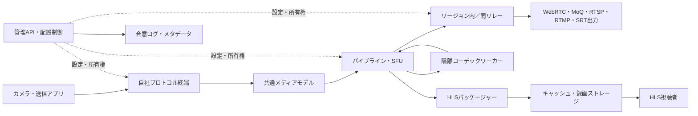

# SENCA 詳細ソフトウェア仕様書

- 文書ID: SENCA-SRS-001
- 版: 1.0（設計ベースライン案）
- 作成日・標準確認日: 2026年10月25日（日本時間）
- 対象: 自社開発の映像・音声収集、処理、分散配送、録画・再生基盤
- 状態: 実装着手に用いる要求仕様案。実装済み、認証済み、性能実測済みを意味しない。

## 1. 目的と前提

SENCAは、WebRTC、MoQ、RTSP、RTMP、SRT、HLS、RTPを共通メディアモデルで接続し、低遅延配信と大規模配信を同一の運用基盤で提供するソフトウェアである。コーデック以外のメディア処理、プロトコル、配信制御、分散制御は原則自社で設計・実装する。

ユーザー確定要件は「名称SENCA」「日本語仕様書」「Markdown配布」「WebRTC・MoQを含むコーデック以外の原則自社実装」である。参照会話ではこの方針を確認したが、過去のアシスタントによる仕様書本文は参照記号のみで取得できなかった。本書の構成、技術選択、性能目標、フェーズは今回の設計提案であり、過去に合意済みとは扱わない。

本書の「必須」はSENCA製品要件を表す。標準のMUST/SHOULD/MAYと同義とは限らない。標準上の要件は別途、条項単位の適合台帳で管理する。標準と本書が矛盾した場合、該当プロファイルの標準を優先し、仕様変更を記録する。

### 1.1 想定用途

- カメラ、放送エンコーダ、ブラウザー、ネイティブアプリからのライブ収集。
- WebRTCによる双方向通信、SFU、低遅延視聴。
- MoQによるオブジェクト単位の購読・中継・キャッシュ配信。
- SRTによる拠点間伝送、RTSPによるカメラ接続、RTMPによる既存配信機器接続。
- HLS／LL-HLSによる多数視聴者向け配信、DVR、録画再生。
- 複数プロトコル間の中継、コンテナ変換、必要時のみトランスコード。

### 1.2 初期対象外

放送局向けの全機能、SMPTE ST 2110、衛星回線制御、広告挿入、課金決済、独自DRM方式、独自暗号方式、全カメラのONVIF制御、任意コーデック対応は初期保証に含めない。画面合成・音声ミキシングは後続フェーズとする。対象外機能の入力は明示的に拒否し、黙って劣化させない。

## 2. 自社実装の境界

### 2.1 原則

「自社実装」は、本番の対象機能について、自社がソース、状態機械、障害解析、更新判断を管理することを意味する。他社製メディアサーバーを包む構成を最終形としない。ただしOS、ハードウェア、ブラウザーまで再実装する意味ではない。

| 領域 | 方針 | 境界・条件 |
|---|---|---|
| WebRTC、ICE、STUN、TURN、SDP、RTP/RTCP、SRTP/SRTCP、SCTP/DCEP | 自社実装 | libwebrtc、Pion、libnice、libsrtp等を本番コアに使用しない |
| QUIC、HTTP/3、WebTransport、MoQ | 自社実装 | 既存QUIC/MoQスタックのラッパーを製品中核にしない |
| RTSP、RTMP、SRT、HLS | 自社実装 | libsrt、既存メディアサーバーへの委譲をしない |
| mux/demux、パケット化、時刻補正、ジッタ制御、SFU、ABR | 自社実装 | FFmpeg/GStreamerのパイプライン・コンテナ・通信機能に依存しない |
| デコード／エンコード | 外部利用可 | libavcodec等のコーデックAPI、ハードウェアSDK。依存機能を監査する |
| リサイズ、色変換、リサンプル、合成、ミキシング | 原則自社実装 | コーデック例外に便乗して処理基盤を外部化しない |
| TLS/DTLSのハンドシェイク、レコード、鍵更新 | 自社実装対象 | 暗号演算・証明書検証は下記境界。公開前の独立監査必須 |
| AES、ChaCha20、SHA、HMAC、HKDF、署名、鍵交換、CSPRNG | 検証済み外部実装 | 自作禁止。OS乱数源と保守中の暗号ライブラリを使用 |
| X.509解析・証明書パス検証、秘密鍵保護 | 外部利用可 | 暗号安全性基盤として例外化。ホスト名・用途・期限等の方針は自社管理 |
| 配置、ルーティング、合意、リース、分散ジョブ | 自社実装 | Kafka/Redis/etcd等を中核の代替として必須化しない |
| OS、TCP/UDP/IP、ドライバー、ファイルシステム | 外部利用 | カーネル、NIC、GPU、DNS、NTP/PTPサービスは基盤依存として許可 |
| コンパイラー、ランタイム、一般データ構造・シリアライズ | 外部利用可 | SBOM、ライセンス、脆弱性管理対象 |
| オブジェクトストレージ、KMS/HSM、監視バックエンド | 外部接続可 | 自社アダプターを用意し、ローカル運用も可能にする |
| ブラウザー内のWebRTC/WebTransport/デコーダ | ブラウザー提供機能 | サーバー・ネイティブSDKの自社実装と区別して表示 |

本番コアへの例外追加には、対象、理由、ライセンス、更新責任者、代替計画、性能・安全性評価をADR（設計判断記録）に記載する。検証用のFFmpeg、GStreamer、libwebrtc、libsrt等は相互接続相手として使用してよいが、本番配送経路に紛れ込ませない。

### 2.2 暗号に関する製品条件

独自暗号アルゴリズム、独自鍵導出、独自ハンドシェイクの発明は禁止する。自社TLS/DTLS実装が監査を通らない場合は公開を延期する。暫定の既存TLS実装を採用する場合は「通信スタック全面自社実装」という表示を行わず、例外を明示する。

暗号ライブラリを使っても、nonce再利用、鍵寿命、認証前の処理、再送攻撃、証明書検証の欠落は自社実装側の責任である。ライブラリ採用だけで安全性を満たしたと判定しない。

## 3. 製品構成とアーキテクチャ

### 3.1 コンポーネント

| コンポーネント | 主な責務 |
|---|---|
| senca-node | ノード起動、資源管理、設定反映、ワーカー監督 |
| senca-gateway | 入出力プロトコル終端、認証、接続制限 |
| senca-media | 共通パイプライン、時刻管理、mux/demux、SFU |
| senca-codec-worker | 外部コーデックを隔離した変換ワーカー |
| senca-relay | ノード間中継、購読集約、短期キャッシュ |
| senca-origin | HLS生成、DVRインデックス、録画の確定 |
| senca-control | API、テナント、ポリシー、配置、desired state |
| senca-consensus | メタデータ合意、所有権、世代番号、設定履歴 |
| senca-agent | 状態報告、ドレイン、更新、ヘルスチェック |
| senca-sdk / sencactl | ネイティブSDK、ブラウザー接続支援、管理CLI |

単一ノードではコンポーネントを同居可能とする。複数ノードでは制御面とメディア面を分離する。コーデックの異常は制御面の停止に波及させない。



### 3.2 実装技術の提案

コアはRustを第一候補とし、C ABIでコーデック・ハードウェアSDKを接続する。Linux x86_64/aarch64を初期本番対象、macOS/Windowsを開発・SDK対象とする。イベント駆動I/O、シャード単位の所有権、参照カウント付きバッファを基本とする。unsafe/FFIは専用モジュールに限定し、利用理由・境界検証・所有権をレビューする。

スレッド数、NUMA配置、受信リング、送信ペーサーは設定可能とする。接続ごとの無制限スレッド生成や無制限キューを禁止する。外部非同期ランタイムの採用可否はP0で固定し、プロトコル状態機械はランタイムから独立して単体検証できる設計とする。

## 4. 共通データモデル

### 4.1 論理モデル

`Tenant → Project → Stream → Track → Rendition → Session`を基本階層とする。

- Tenant: 認可・請求集計・資源上限の境界。
- Stream: 論理配信。入力切替や再接続でIDを維持できる。
- Track: 映像、音声、字幕、時刻付きメタデータ。
- Rendition: コーデック、解像度、帯域、レイヤーが異なる表現。
- Session: 個々のpublish/playback接続。Streamと寿命を分離する。
- Epoch: 入力再起動や不連続を表す単調増加世代。
- Recording: Streamの一定期間に対応する確定済みメディアと索引。

### 4.2 内部メディア単位

```text
EncodedAccessUnit {
  tenant_id, stream_id, track_id, rendition_id,
  epoch: u64,
  sequence: u64,
  codec, codec_config_id,
  pts: i64, dts: optional<i64>, duration: u64,
  timebase_num: u32, timebase_den: u32,
  capture_time_ns: optional<i64>, clock_uncertainty_ns: optional<u64>,
  keyframe: bool, dependency_info: optional<DependencyInfo>,
  discontinuity: bool, deadline_mono_ns: u64,
  payload: immutable_refcounted_buffer
}
```

内部IDは推測困難な128bit IDを使用し、機密性をIDの秘匿だけに依存させない。時刻換算はオーバーフロー検査付き整数演算で行う。DTSを持たない入力にPTS=DTSを無条件適用しない。Bフレームがある入力を扱えない低遅延出力では、変換または拒否を行う。

RTPパケット、MoQオブジェクト、TSパケットを同一概念として扱わない。プロトコル固有情報は側帯メタデータに保持する。MediaEnvelopeのスキーマは版管理し、必須フィールドの欠落や未対応版は拒否する。

### 4.3 時刻と同期

受信順序、メディアPTS/DTS、単調時計、壁時計を分離する。RTP timestampのwrap、RTCP Sender Report、TS PCR/PTS/DTS、RTMP timestampを各アダプターで拡張・正規化する。壁時計のNTP補正でメディア順序を逆行させない。

音声を基本の再生クロックとし、映像の遅延・破棄と音声の限定的リサンプルで同期する。初期目標は音声・映像の提示時刻差の絶対値p95が80ms以下。時刻源不明の入力ではcapture-to-display測定値を生成せず、受信後遅延として区別する。

## 5. メディアパイプライン

### 5.1 基本経路

```text
Receive → Authenticate/Decrypt → Parse → Reorder/Repair → Depacketize/Demux
        → Clock Normalize → Route/Select
        → [Decode → Filter/Mix → Encode]
        → Packetize/Mux → Encrypt → Pace → Send
```

暗号化プロトコルでは、認証タグの検証が完了する前にペイロードをデコーダへ渡さない。SRTの認証付き暗号でない互換モード等は別ポリシーとし、同じ保証を表示しない。

パイプラインは有向非巡回グラフで定義し、ノードごとに入力形式、出力形式、時刻基準、バッファ上限を宣言する。グラフの検証後に新世代を準備し、キーフレーム等の安全な境界で切替える。失敗時は旧世代を継続し、APIへ失敗理由を返す。

### 5.2 処理モード

| モード | 条件 | 動作 |
|---|---|---|
| Forward | 同一コーデック・互換パケット化 | 可能な範囲でペイロードを共有して転送 |
| Repacketize | コーデック互換、搬送方式が異なる | 自社packetizerで組み直す |
| Remux | コーデック互換、コンテナが異なる | 自社muxerで再格納 |
| Transcode | 非互換または画質変更が必要 | 外部コーデックを呼び出す |
| Reject | 変換不可、ライセンス不足、資源不足 | 明示エラー。無期限に待機しない |

### 5.3 バッファと過負荷

初期既定値は低遅延経路のキュー時間250ms、1トラック8MiB、1セッション32MiBとし、いずれか先に到達した制限を適用する。SRT受信バッファ、DVRキャッシュ等は用途別の上限を別に設ける。最大Access Unitは初期16MiBとし、大きいフレームが必要なプロファイルのみ明示変更する。

輻輳時は低優先レイヤーを落とし、期限切れフレームを破棄し、必要なら次の独立復号点へ移る。依存フレームだけを残して壊れたGOPを転送しない。音声優先であっても無限待機を許可しない。ライブの低遅延経路と欠落を抑えたい録画経路は別キューに分岐し、録画の遅さが視聴者を停止させない。

### 5.4 コーデック・コンテナ

初期映像はH.264とVP8、音声はOpusとAACを主対象とする。WebRTCの必須コーデック要件は選択した端点種別について別途満たし、音声端点ではG.711 PCMA/PCMU等も適合台帳に含める。VP9、AV1、HEVCは後続の明示プロファイルとする。

H.264 Annex Bとlength-prefixed形式の変換、SPS/PPS管理、codec configurationの世代管理は自社実装。AAC ADTS/AudioSpecificConfig、Opus設定、サンプル境界を検証する。外部コーデックが対応していても全プロトコルで搬送可能とはみなさない。

自社mux/demux対象はMPEG-TS、FLV、ISO BMFF/fMP4。TSではPAT/PMT、PID、連続性カウンター、PCR、PES、CRCを扱い、fMP4では初期化セグメント、fragment、sample timing、composition offsetを扱う。CMAF適合を名乗る場合は対応するISO仕様を取得し、独立した適合試験を追加する。

## 6. プロトコル対応プロファイル

### 6.1 全体マトリクス

| プロトコル | 入力 | 出力 | 本番の基本範囲 | 後続・限定機能 |
|---|---|---|---|---|
| RTP/RTCP | 受信 | 送信 | unicast、SR/RR、時刻同期、payload mapping | multicast、追加FEC |
| RTSP | クライアントpull | サーバーplay | RTSP 1.0、UDP/TCP interleaved | RTSP 2.0、push/RECORD |
| RTMP/RTMPS | server publish、client pull | client publish、server play | TCP、H.264/AAC、AMF0 | E-RTMP、AMF3必要部分 |
| SRT | caller/listener | caller/listener | live、ARQ、TSBPD、MPEG-TS | rendezvous、bonding、FEC |
| WebRTC | publish | playback、双方向SFU | ICE、DTLS-SRTP、RTP/RTCP、SDP | 高度なSVC、E2EE、完全DataChannelプロファイル |
| HLS | client pull | origin配信 | live/VOD、TS/fMP4、ABR、DVR | LL-HLS、暗号化HLS、DRM連携 |
| MoQ | publish/subscribe | publish/subscribe/relay | 固定ドラフト、native QUIC | WebTransport、追加メディア形式 |

「後続」は未実装でもよいという製品全体の免責ではなく、各フェーズの出荷範囲を限定する。製品APIは実装済み機能だけをcapabilitiesとして返す。

### 6.2 RTP/RTCP

自社実装範囲はRTPヘッダー、CSRC、拡張、padding、sequence/timestamp wrap、SSRC衝突検出、受信順序復元、損失計測、RTCP SR/RR/SDES/BYE、帯域制御、送信間隔計算とする。基準はRFC 3550であり、拡張ごとに別の標準を適用する。[S01]

H.264、VP8、Opus、G.711のpayload formatを初期対象とし、fragment欠落、不正長、未知payload type、未交渉拡張を処理する。NACK/PLI/FIR/RTX、RTCP mux、reduced-size RTCPはプロファイルで宣言する。PLI/FIRは集約・間隔制限し、大規模視聴によるキーフレーム要求の集中を防ぐ。

再送は受信側の再生期限と再送予測時間から判断し、再生期限超過後のRTXを積み上げない。SFUでsequence/SSRCを書き換える場合は、RTCP、NACK、RTXの逆引き対応を保つ。裸RTPには暗号保護がないため、信頼された閉域接続に制限する。

### 6.3 WebRTC

IETFのWebRTC全体構成、メディア要件、transport要件、安全性要件に従う。ブラウザー互換メディア端点と完全なWebRTC端点の適合範囲を区別する。DataChannel未実装の段階で、WebRTC全体への完全準拠を主張しない。[S02][S03][S04]

必須の自社実装項目:

1. SDP offer/answer、media section、MID、BUNDLE、rtcp-mux、codec/fmtp、RTCP feedback、方向属性、DTLS fingerprint、ICE情報の交渉。
2. ICEの候補収集・優先度・connectivity check・nomination・role conflict・再起動。STUNの整合性検査、TURN allocation/permission/channel/lifetime、認証と割当上限。
3. full ICEをネイティブSDKの基本とする。サーバーのICE-liteは条件に適合する構成でのみ選択可能とする。trickle ICEとconsent freshnessを実装する。
4. DTLS 1.2互換を初期必須とし、DTLS-SRTPによる鍵導出・保護プロファイル交渉、SRTP/SRTCPの認証、replay window、rollover counter、鍵寿命を管理する。
5. NACK、PLI、RTX、パケットpacing、帯域推定、ジッタバッファ。transport-wide feedback等は仕様・相手の対応版を固定し、独自実装と標準化状況を混同しない。
6. simulcastのRID/SSRC対応、レイヤー選択、キーフレーム境界切替、参加者ごとの上り／下り帯域制御。
7. DataChannelを提供するプロファイルではSCTP over DTLS、DCEP、信頼性／順序設定、fragment/reassembly、stream resetを実装する。

JSEPの参照はRFC 9429を基準とする。シグナリング輸送自体はWebRTCが一意に定めるものではなく、SENCA APIとWHIPを提供する。[S05][S06]

WHIPはRFC 9725に基づく独立エンドポイントとし、SDP POST、Location、セッション削除、該当するPATCH/ETag等を標準どおり扱う。SENCA固有JSON APIをWHIPとして公開しない。WHEPは採用時点の文書状態と版を確認してから追加し、本書では確定標準として扱わない。

ブラウザーのJavaScriptからブラウザー内のICE/DTLS等を置換する設計は行わない。ブラウザーSDKは標準APIを呼ぶ薄い接続層であり、サーバー／ネイティブSDKで自社スタックを実装する。

### 6.4 QUIC・HTTP/3・WebTransport

QUIC v1のpacket parsing、packet number空間、ACK、stream管理、flow control、connection ID、path validation、migration、Retry、anti-amplification、終了処理を自社実装する。TLS 1.3連携、鍵更新、header protectionはRFC 9001、損失検出・PTO・輻輳制御はRFC 9002を基準とする。[S07][S08][S09]

QUIC DATAGRAM、HTTP/3、QPACK、HTTP Datagrams、拡張CONNECTとWebTransportはそれぞれ独立モジュールとし、採用仕様を台帳に固定する。native QUICでMoQが動いても、ブラウザーWebTransport対応が完了したとは扱わない。UDP遮断環境はHLS/WebRTC TURN等の別経路を明示選択する。

初期は変更を伴う操作の0-RTTを禁止する。初期リリースは0-RTT自体を無効化してよい。再開チケットの鍵ローテーション、接続数、stream数、フロー制御上限、QPACK blocked stream数、ヘッダー総量を制限する。

### 6.5 MoQ

確認時点の基準候補は`draft-ietf-moq-transport-22`である。MoQはInternet-Draftとして扱い、RFC準拠・将来版互換を保証しない。P0で仕様本文と関連仕様を固定し、ハッシュ・取得日を保存する。[S10]

自社実装対象はセッション確立、版交渉、namespace/track管理、publish/subscribe、fetch、購読終了、object/group/subgroup、stream/datagram転送、優先制御、relay、期限付きcacheである。ワイヤーのメッセージ名・フィールド・varintは固定版から生成・検証し、旧版やQUIC varintの実装を無条件流用しない。

SENCA固有要件:

- 同一オブジェクト識別子には同一内容を対応させ、キャッシュ後の書換えを禁止する。
- namespaceのpublish権限とsubscribe権限を毎回検証する。tenant境界を文字列前方一致だけで判定しない。
- メディアpayload format、catalog、コーデック設定、時刻、キーフレームとgroupの関係を別プロファイルとして固定する。transportだけでプレーヤー互換を保証しない。
- ライブは期限優先、DVR/fetchは別の帯域予算を持つ。期限切れオブジェクトを購読キューから除去する。
- 変更版は別アダプターで実装し、検証済みの版のみ交渉する。未知版を推測して接続しない。
- relayが扱うメタデータとpayload暗号化の境界を公開し、QUICの区間暗号化とE2EEを区別する。

初期メディアmappingはP0で相互接続相手と一緒に決定する。決定前は実験扱いとし、MoQの一般相互接続を製品保証に含めない。

### 6.6 RTSP

既存カメラ互換のためRTSP 1.0（RFC 2326）を初期対象とし、RTSP 2.0（RFC 7826）は別状態機械・別適合表とする。2.0が1.0を置き換える仕様であっても、両者のワイヤー互換を仮定しない。[S11]

初期メソッドはOPTIONS、DESCRIBE、SETUP、PLAY、PAUSE、TEARDOWN、必要なGET_PARAMETER/SET_PARAMETER。CSeq、Session、timeout、Transport、Range、認証challenge、SDPを検証する。UDP unicastとTCP interleavedを実装し、interleavedのフレームとRTSPメッセージの混在を安全に解析する。

pull再接続は指数バックオフとjitterを用い、重複セッションを破棄する。Digest認証の版・アルゴリズムは相互接続表で宣言し、BasicはTLSまたは明示的な閉域例外に限定する。RTSP 1.0のレガシー認証対応を最新の安全性保証と同義にしない。RECORD、multicast、独自カメラ拡張は別プロファイルとする。

### 6.7 RTMP／RTMPS

handshake、chunk stream、chunk size、message reassembly、extended timestamp、ack window、peer bandwidth、user control、AMF0 command、connect/createStream/publish/play/deleteStream、FLV audio/video/dataを自社実装する。RTMPSはTLSを通す。同時chunk stream数、メッセージサイズ、AMFの深さ・要素数を制限する。

初期は従来のH.264/AACを対象とする。E-RTMPはVeoveraの仕様を版・commit固定して追加し、FourCC、追加コーデック、マルチトラック等を一括対応とせず機能別に宣言する。[S12]

公開ネットワークはRTMPSを既定とする。RTMPしか使えない機器は閉域または安全なトンネル内に限定する。stream keyは保存時に保護し、ログ・エラーメッセージ・監視ラベルに出さない。

### 6.8 SRT

SRTはHaivision公開仕様・技術資料と固定した参照実装版を基準に互換性を検証する。IETF Standards Track RFCと表示しない。[S13]

UDP上のhandshake、socket ID、sequence、timestamp、ACK/NAK、再送、TSBPD、Too-Late Packet Drop、flow/congestion control、keepalive、終了、stream ID、鍵交換・鍵更新を自社実装する。live modeのcaller/listenerを必須とし、rendezvous、file mode、bonding、FECは別出荷とする。

初期payloadはMPEG-TS。帯域、RTT、損失から再送予算を計算し、受信遅延を設定可能にする。「必ず無損失」「常にサブ秒」は保証しない。必要な遅延は回線と再送可能回数に依存する。

暗号処理は採用SRT版の仕様に合わせる。従来のAES-CTR互換モードを認証付き暗号と表示しない。機密性、完全性、送信者認証の保証を分け、完全性が必要な経路では安全なトンネル等を必須にする。共有passphraseはテナント単位で分離・ローテーションし、鍵長・鍵寿命・nonce構成を試験する。暗号有効側と無効側の不一致で平文へ黙って降格しない。[S14]

### 6.9 HLS／LL-HLS

HLSはRFC 8216を基礎とし、Apple向け適合はAuthoring Specificationを追加適用する。LL-HLSをRFC 8216だけで完全に定義される機能として扱わない。[S15][S16]

自社実装対象はmaster/media playlist、variant/audio group、media sequence、discontinuity sequence、target duration、EXT-X-MAP、byte range、program date time、endlist、live window、VOD index、TS/fMP4分割、HTTP配信・cache制御とする。

LL-HLSはpartial segment、blocking reload、preload hint、rendition report、delta update、server controlを採用版に従い追加する。待機要求数・保持時間に上限を置き、切断で待機資源を解放する。part durationは回線RTTとApple要件から決め、低遅延という理由だけで極端に小さくしない。

セグメントを確定してからplaylistで公開する。途中書込みを完成セグメントとして配信しない。複数variantのキーフレーム境界・時刻を揃え、削除猶予を保持する。認可済み配信でcache keyを共有する場合も、各要求で配信権限を検証し、公開cacheへ機密内容を混入させない。

暗号化HLS、SAMPLE-AES、DRMは別プロファイルとし、鍵配布・ライセンス・再生環境まで試験する。DRMの独自実装を前提にせず、必要時は承認済み外部CDM/ライセンスサービスを例外に加える。

## 7. プロトコル変換ルール

| 入力 → 出力 | 基本経路 | 追加条件 |
|---|---|---|
| RTSP H.264 → WebRTC H.264 | depacketize/repacketize | profile、packetization、Bフレーム、音声互換を確認 |
| RTMP H.264/AAC → HLS | remux | 時刻補正、GOP境界、AAC設定の整合 |
| SRT TS → HLS | demux/remux | PCR/PTS、欠落・不連続の検出 |
| WebRTC H.264/Opus → HLS H.264/AAC | 映像remux＋音声transcode | 対象プレーヤーの対応プロファイルに合わせる |
| WebRTC VP8 → HLS H.264 | transcode | CPU/GPU枠とコーデックライセンス |
| HLS → WebRTC | demux＋必要時transcode | 入力segment蓄積遅延は消去できない |
| RTP/RTSP/SRT → MoQ | AU化＋MoQ mapping | 固定したpayload/catalogプロファイルが必要 |
| MoQ → WebRTC/HLS | mapping復元＋出力整形 | E2EE payloadは復号権限なしでは変換不可 |

変換計画APIは実行前に`passthrough/remux/repacketize/transcode/unsupported`と理由、必要資源、想定追加遅延を返す。未知の組合せを自動で成功扱いにしない。

## 8. 分散処理・配置・障害復旧

### 8.1 制御面

制御メタデータは3台または5台の投票ノードによる自社Raft実装を候補とする。ログ複製、永続化、snapshot、再起動復元、joint consensusによる構成変更を対象とする。合意をgossipや時刻順比較で代替しない。gossipは補助的な発見・状態伝播に限定する。

書込み成功は多数派での永続化と適用条件を満たした時点で返す。強整合readはReadIndex等の安全な方式で行う。過半数喪失時は新規配置・設定変更・所有権取得を停止する。既存メディアは安全に継続可能な範囲で継続する。

### 8.2 所有権と二重実行防止

Streamごとにowner、epoch、lease、fencing tokenを管理する。所有権変更は合意ログ経由で行う。時刻ベースleaseだけでsplit brainを防げるとはみなさない。録画manifest、出力公開、外部副作用を行う受信先は最新fencing tokenを検証する。

ネットワーク分断時の旧ownerは期限終了で公開・書込みを停止する。ストレージ側でfencingができない構成はimmutableな世代別オブジェクトへ書込み、公開manifestだけを強整合に更新する。

### 8.3 メディア面

メディア本体を合意ログへ格納しない。地域、RTT、CPU/GPU、NIC帯域、codec能力、テナント上限で配置する。relayは同一trackの購読を集約し、同一上流からの重複取得を抑える。経路にhop上限とloop検出IDを設ける。

単一接続の状態を自由に別ノードへ移せるとは仮定しない。WebRTC/QUIC/SRTのworker故障では再接続・再交渉を基本とし、新しい暗号セッションを確立する。SRTPやQUICの鍵・nonce状態を不完全に引継いで同一鍵を再利用しない。

### 8.4 ジョブと録画

トランスコード・録画後処理ジョブはat-least-once配送を前提に、job IDと成果物IDで冪等化する。「exactly once」を一般保証しない。immutable出力＋条件付きmanifest更新で二重公開を防ぐ。

録画は`recording_id/epoch/track/segment`で格納し、checksum、開始終了PTS、codec config、欠落区間を索引に保持する。障害後は確定済みsegmentを回収し、未完了segmentは破損を検出して除外する。保持期限・法的保全・削除状態を区別する。

### 8.5 マルチリージョン

初期はリージョン内強整合、リージョン間はメディア中継と非同期バックアップとする。全世界を単一の同期合意にすることは標準構成にしない。DR切替は明示昇格と所有権の再確立を必要とし、データ損失可能範囲を表示する。

## 9. セキュリティ仕様

### 9.1 脅威モデル

攻撃者はインターネットから不正packet/SDP/playlistを投入でき、URLやstream IDを推測し、接続を大量作成し、遅い受信者になり、パケットを再送・改変できるものとする。テナント管理者が別テナントの資源を狙う場合、侵害されたcodec worker、資格情報流出、制御面分断も対象とする。

信頼境界は、外部端末／gateway、tenant間、gateway／codec worker、メディア面／制御面、node間、storage/KMS間に設定する。

### 9.2 認証・認可

管理APIはOIDC/JWTまたはmTLS。JWTのissuer/audience/expiry/not-before/署名alg/key用途を検証し、`alg=none`と意図しないalgorithm切替を拒否する。鍵取得URLをtoken値から無制限に探索しない。node間はmTLSとnode登録を必須とする。

権限は`stream:read`、`stream:write`、`publish`、`subscribe`、`recording:read`、`recording:delete`、`tenant:admin`等に分離し、tenant/project/streamの範囲を持つ。短命なセッショントークンの初期TTLは5分、長時間視聴は認可を更新する。失効反映目標は60秒以内。認可サービス不能時の継続猶予は用途別に設定し、新規接続はfail closedとする。

### 9.3 暗号と鍵

- 管理API、内部通信、QUICはTLS 1.3を基本とする。RTMPS等のTLS 1.2互換は必要な安全プロファイルに限定する。
- DTLSはブラウザー相互接続に必要な版を明示し、TLSの設定をそのまま転用しない。
- 証明書の有効期限、ホスト名、信頼anchor、用途、署名を検証する。DTLS-SRTPは認可されたシグナリングのfingerprintと照合する。
- CSPRNGはOS提供源を用い、seed不足や乱数取得失敗時はセッションを確立しない。
- 鍵はKMS/HSMまたは保護されたsecret storeに保持し、設定・ログ・crash dumpへ出さない。
- 接続・方向・世代ごとに適切に鍵を分離し、nonceとpacket counterの上限到達前に更新／終了する。
- replay window、tag長、定数時間比較、認証失敗のエラー経路を検証する。
- 規格認証が必要な案件では暗号モジュールだけでなく使用モード・運用条件まで別途確認する。本書はFIPS等の認証取得を意味しない。

E2EEは区間暗号化とは別機能。SFUが復号しないE2EEでは、サーバーでのtranscode、合成、内容検査、通常録画再生に制約が生じる。E2EEモードは変換計画時に不可能な処理を拒否する。

### 9.4 入力・資源防御

初期上限としてSDP 256KiB、HTTP header合計32KiB、JSON body 1MiB、AMF/JSON nesting 32、RTMP message 16MiBを設定する。版・用途ごとに調整可能だが無制限設定は公開環境で禁止する。プロトコル本来の制限が厳しい場合はそちらを優先する。

parserは長さ・整数演算・重複field・fragment総量・タイムアウトを検証する。UDPの応答増幅、TURN open relay、接続前の高価な暗号処理、keyframe要求連打を防ぐ。IP単位だけでなくtenant、token、接続、node単位の制限を持つ。

pull URLはSSRF対策を行い、許可scheme、宛先ポリシー、DNS再解決後のIP、redirect先を検査する。loopback/link-local/cloud metadata宛先を既定拒否し、私設カメラ宛先は管理者の許可ネットワークでのみ解放する。

codec workerは権限・filesystem・network・CPU/memoryを制限する。プラグインは署名済み配布物のみ読み込み、任意のremote codeをAPIでロードさせない。

### 9.5 監査と供給網

変更主体、対象tenant、操作、結果、request ID、時刻を監査ログへ保存する。秘密情報・メディア本体・生のtokenは保存しない。SBOM、依存ライセンス、脆弱性監視、署名付きrelease、再現可能なbuild手順を出荷条件とする。codec特許・再配布条件は採用方式と提供地域に応じて別途確認する。

## 10. 管理API

### 10.1 共通契約

base pathは`/api/v1`、JSON UTF-8、時刻はUTC RFC 3339。仕様はOpenAPIとして実装時に同梱する。API版とメディアプロトコル版を分離する。tenantは認証contextから決定し、bodyのtenant IDを信用しない。

POSTの副作用は`Idempotency-Key`で24時間重複抑止する。同一key・異なるbodyは409。更新はETagと`If-Match`を使用し、古い版は412。非同期処理は202とoperation resourceを返す。作成は201とLocationを返す。

listはcursor pagination（既定100、最大1000）、安定順序、filterを提供する。404は存在しない場合と閲覧権限がない場合の情報漏えいを防ぐ用途に用いる。429にはRetry-After、503には再試行可否を示す。

### 10.2 エンドポイント

| Method / Path | 動作 | 権限・結果 |
|---|---|---|
| GET /capabilities | 対応版・codec・機能一覧 | 認証済み、200 |
| POST /streams | 配信定義作成 | stream:write、201 |
| GET /streams/{id} | desired/observed状態取得 | stream:read、200 |
| PATCH /streams/{id} | 設定更新 | stream:write、202、If-Match |
| DELETE /streams/{id} | 新規接続停止・資源解放 | stream:write、202 |
| POST /streams/{id}/inputs | pull/push入力定義 | stream:write、201 |
| POST /streams/{id}/outputs | 出力定義 | stream:write、201 |
| POST /streams/{id}/plan | 変換・資源計画 | stream:read、200、副作用なし |
| POST /streams/{id}/sessions | publish/playback session作成 | publish/subscribe、201 |
| DELETE /sessions/{id} | 接続終了 | 所有者または管理者、204 |
| POST /streams/{id}/recordings | 録画開始 | stream:write、202 |
| GET /recordings/{id} | 索引と状態 | recording:read、200 |
| DELETE /recordings/{id} | 削除ジョブ | recording:delete、202 |
| GET /operations/{id} | 非同期処理状態 | 対象資源の権限、200 |
| GET /events | SSEイベント購読 | 権限filter、200 |
| GET /nodes | node状態 | tenant外の運用権限、200 |
| POST /nodes/{id}/drain | 新規割当停止 | 運用権限、202 |

DELETE streamは録画を自動削除しない。録画削除は別APIで明示する。credentialsはsecret referenceで指定し、GET応答に秘密値を含めない。

### 10.3 配信作成例

```http
POST /api/v1/streams
Authorization: Bearer <access-token>
Idempotency-Key: create-studio-a-001
Content-Type: application/json
```

```json
{
  "name": "studio-a",
  "latency_profile": "interactive",
  "input": {
    "protocol": "srt",
    "mode": "listener",
    "payload_format": "mpegts",
    "credential_ref": "secret:srt/studio-a"
  },
  "outputs": [
    {"protocol": "webrtc", "profile": "media-v1"},
    {"protocol": "hls", "profile": "hls-fmp4-v1"}
  ],
  "transform": {
    "video": "passthrough_if_compatible",
    "audio": "auto",
    "allow_transcode": true
  },
  "recording": {"enabled": false},
  "limits": {"max_viewers": 1000, "max_ingress_bps": 20000000}
}
```

```json
{
  "id": "st_01_example",
  "generation": 1,
  "desired_state": "running",
  "observed_state": "provisioning",
  "operation_id": "op_01_example",
  "created_at": "2026-10-25T00:00:00Z"
}
```

IDは説明用であり実際のID形式を省略している。入力codec判明前は変換計画を暫定状態とし、必要資源が確保できない場合はfailed/degraded理由を返す。

### 10.4 状態とエラー

Streamの状態は`created → provisioning → waiting_input → live → draining → stopped`を基本とし、`degraded/failed`を障害状態とする。desired stateとobserved stateを別fieldにし、API成功をメディア出力成功と誤認させない。

```json
{
  "type": "urn:senca:error:unsupported-codec",
  "title": "出力プロファイルで扱えないコーデックです",
  "status": 422,
  "code": "UNSUPPORTED_CODEC",
  "request_id": "req_example",
  "retryable": false,
  "details": {"output": "webrtc", "track": "audio"}
}
```

主なcodeは`INVALID_CONFIG`、`UNSUPPORTED_PROTOCOL_VERSION`、`UNSUPPORTED_CODEC`、`AUTH_FAILED`、`QUOTA_EXCEEDED`、`CAPACITY_UNAVAILABLE`、`INPUT_TIMEOUT`、`OWNERSHIP_LOST`、`INTERNAL_ERROR`とする。内部stackやsecretをdetailsへ入れない。

### 10.5 シグナリングとイベント

SENCA固有WebRTCセッションAPIはSDP offer/answer、trickle candidate、ICE restartを定義し、WHIPの標準endpointとは分離する。WHIPは`/whip/{stream_id}`等の専用URIを提供する。HLS playback URLやMoQ namespace等はセッション作成応答に期限・適用権限とともに返す。

イベントは`event_id/type/resource_id/generation/occurred_at/data`を持つ。SSEの再接続はLast-Event-IDを受け付け、保持期間24時間を超える場合は再同期を要求する。イベント配送はat-least-onceであり、利用側はevent_idで重複排除する。初期版では外部webhook配送を必須としない。

## 11. SDK・内部モジュールAPI

ネイティブSDKはC ABIを安定境界とし、Rustラッパーと必要な言語bindingを提供する。ブラウザーSDKは接続、再接続、品質変更、統計取得を提供する。公開APIから秘密鍵や内部メモリpointerを露出させない。

```text
ProtocolAdapter: open(config) → negotiate() → poll_event() → close(reason)
MediaSource: next_access_unit(deadline) → unit | discontinuity | end
MediaSink: push(unit) → accepted | backpressure | rejected
CodecProvider: capabilities() / create_encoder() / create_decoder()
Pipeline: validate(graph) / prepare(generation) / commit() / rollback()
Scheduler: reserve(resources, ttl) / commit(reservation) / release()
CryptoProvider: random / aead / hash / mac / kdf / sign / verify / key_exchange
```

暗号providerはraw鍵の露出を最小化し、ハンドル型を優先する。CodecProviderはコーデック処理以外のURL接続、mux/demux、任意filterの実行を提供しない。cancel、timeout、所有権、thread safety、callback再入可能性を各APIで明文化する。

## 12. 設定・運用・可観測性

設定は版付きYAML/JSONとし、起動時・更新時にschema検証する。秘密値はsecret referenceで与える。無効な設定を部分反映しない。hot reload可能な閾値と、接続再確立が必要な暗号・transport変更を区別する。

メトリクスは入出力bitrate、packet loss、RTX/NAK、RTT、jitter、queue時間、期限切れdrop、codec時間、GPU使用率、接続数、視聴開始時間、rebuffer比率、録画欠落、合意commit遅延、lease失効を含む。protocol/tenant/region単位の集計を可能にし、session IDの常時ラベル化による高cardinalityを避ける。

ログは構造化し、request/session/stream/node IDで相関可能にする。トレースはサンプリングし、フレームごとの全量記録を既定にしない。packet captureは明示的な診断モードのみで、アクセス制限・短期保持・秘密除去を設ける。

livenessとreadinessを分離する。依存先停止を理由に全nodeを同時再起動しない。rolling updateは新規割当停止、既存接続drain、期限後の再接続誘導の順に行う。実行形式が変わる前にメタデータの後方互換を検証する。

## 13. 性能・信頼性目標

以下は初期の設計目標であり、測定前の保証値ではない。P0で試験機材を固定し、実測結果に基づき出荷profileと容量上限を決定する。

### 13.1 基準環境

- データnode: 専有16物理core、64GiB RAM、25GbE、NVMe、Linux。CPU型番・kernel・NIC・build hashを記録。
- 制御node: 3台、別障害ドメイン。各8core・16GiB以上を試験基準とする。
- 基本メディア: 1080p30 H.264 4Mbps＋音声128kbps、GOP 1秒、Bフレームなし。
- N0: RTT 10ms、損失0%、jitter 2ms以下。
- N1: RTT 50ms、ランダム損失1%、jitter 10ms、使用帯域の1.5倍以上の回線容量。
- N2: RTT 150ms、損失3%、100ms burst loss、帯域急減。劣化時の安全性・回復試験。

### 13.2 目標値

| 指標 | 目標 | 測定条件 |
|---|---|---|
| WebRTC end-to-end遅延 | p95 ≤500ms | N1、対応browser、変換なし、capture/display時刻計測 |
| native MoQ end-to-end遅延 | p95 ≤800ms | N1、固定mapping、自社player、変換なし |
| LL-HLS遅延 | p95 ≤5秒 | N1、part 1秒の初期profile、対応player |
| 通常HLS遅延 | p95 ≤12秒 | N1、segment 2秒、player設定固定 |
| 音声・映像同期差 | 絶対値p95 ≤80ms | 時刻同期可能な素材、30分以上 |
| WebRTC視聴開始 | p95 ≤2秒 | N1、認可開始から最初の映像提示 |
| メディア処理追加時間 | p95 ≤20ms | N0、node内、変換・意図的buffer除外 |
| 制御API読取り | p95 ≤200ms | 100 req/s、同一region、強整合read |
| 転送容量 | 同時1000視聴・概算4.2Gbps | N0、変換なし、CPU平均70%以下、packet化差分を実測 |
| 長時間安定性 | 72時間 | RSS増加傾向なし、warm-up後増分5%以内 |

1000視聴はGPU変換1000本の意味ではない。転送、暗号化、TURN中継、トランスコードは別capacity profileを公開する。必要送信帯域は視聴者数×平均bitrate＋protocol/retransmission余裕で計算し、NIC帯域だけで収容数を決めない。

### 13.3 復旧・可用性

- 制御面1台故障: 新leader確立と書込み再開p95 5秒以内を目標。
- メディアworker故障: 再接続可能な試験clientで映像復旧p95 10秒以内。無停止は保証しない。
- 確定メタデータRPO: 単一障害かつ多数派永続領域存続時に0。全リージョン喪失には適用しない。
- 録画RPO: 共有storageへ確定済みsegmentは単一worker故障で消失しない。未確定部分は最大1segmentを設計目標とする。
- DRバックアップ: 初期目標RPO 5分・RTO 30分。実際のデータ量を使う復旧演習で検証。
- サービス可用性: 運用開始後の目標99.95%/月。利用者側回線障害を分離し、外形監視による接続・再生成功をSLIとする。出荷試験だけで月間達成を認定しない。

## 14. 開発フェーズと完了条件

日程は人員、監査体制、既存資産が未確定のため固定しない。自社QUIC/TLS/DTLS、WebRTC、分散合意の開発は独立した大規模作業であり、単一の短期MVPに圧縮しない。

| Phase | 範囲 | 完了条件 |
|---|---|---|
| P0 要件・標準固定 | 適合台帳、ADR、脅威モデル、codec/暗号依存、試験環境 | 対応版、対象外、性能測定法、MoQ mappingを確定 |
| P1 メディア基盤 | 共通モデル、RTP/RTCP、TS/FLV/fMP4、codec ABI、単一node | parser/fuzz、時刻wrap、不連続、72hの基礎試験合格 |
| P2 収集・通常配信 | RTSP 1.0、RTMP/S、SRT live、HLS、録画、API | 各protocolの2実装以上との接続、変換・認可試験合格 |
| P3 WebRTC | ICE/STUN/TURN、DTLS-SRTP、SDP、WHIP、SFU、帯域制御 | browser相互接続、NAT/TURN、遅延、独立security review合格 |
| P4 分散本番化 | 合意、配置、fencing、relay、drain、backup | 分断・disk故障・旧owner拒否・DR演習に合格 |
| P5 MoQ・QUIC | QUIC/TLS1.3、MoQ fixed draft、native SDK | QUIC適合、MoQ相互接続、版違い拒否、監査合格 |
| P6 拡張 | WebTransport、LL-HLS、E-RTMP、SVC、新codec、DataChannel完全profile | 各機能の適合表と追加受入試験合格 |
| P7 運用成熟 | multi-region、E2EE、合成、最適化 | 対象機能ごとの保証範囲を再定義して出荷 |

P3とP5等は体制があれば並行開発できるが、共有暗号基盤とメディアモデルの版を先に安定させる。P2出荷でWebRTC/MoQ未対応の場合は、製品のロードマップと実装済み機能を明確に分ける。TLS/DTLS公開経路は該当監査gateを通過するまで外部提供しない。

## 15. 受け入れ基準

### 15.1 試験方針

相互接続、標準適合、性能、安全性を別に判定する。「同じ自社実装同士で接続できた」は標準適合の証拠にしない。標準の各MUSTに実装箇所・試験IDを紐付け、SHOULD逸脱は理由を記録する。

相互接続相手は異なる独立実装を選び、相手版、OS、設定、capture、期待結果を保存する。browserは試験時点の安定版Chrome/Firefox/Safariを対象に版を固定する。変更がない試験環境だけの成功を恒久的な互換保証にしない。

### 15.2 試験一覧

| ID | 対象・手順 | 合格条件 |
|---|---|---|
| AC-01 | 全parserへ境界長、不正長、切断fragment、整数最大値投入 | crash、OOB、無制限確保、無限loopがない |
| AC-02 | 独立実装とのRTP/RTCP送受信、wrap・SSRC変更 | 正しい復元・統計・同期、誤トラック混入ゼロ |
| AC-03 | RTSP 1.0の2実装以上、UDP/TCP、認証、再接続 | 30分連続再生、切断後復旧、資源残留なし |
| AC-04 | RTMP publish/playを独立2実装以上で相互接続 | A/V同期、chunk変更、extended timestamp正常 |
| AC-05 | SRT参照版および別機器、N0/N1/N2、鍵更新 | 回復可能範囲で正常再生、期限超過を計測、平文降格なし |
| AC-06 | HLS validator＋Safari系と独立player | playlist違反なし、ABR切替・終了・DVR seek正常 |
| AC-07 | 3browser family、IPv4/IPv6、NAT、UDP遮断 | 直接または宣言済みTURN経路で接続、失敗理由を識別 |
| AC-08 | WebRTC renegotiation、ICE restart、RTX、simulcast | deadlockなし、別参加者への誤配送ゼロ |
| AC-09 | QUIC独立実装とのhandshake/stream/loss/migration | 採用profileの適合試験合格、増幅上限違反なし |
| AC-10 | 固定MoQ版でpublish/subscribe/fetch/relay、未知版接続 | 内容一貫性、認可、期限処理が正しく、未知版は明示拒否 |
| AC-11 | 対応変換表の全組合せと非対応codec入力 | 計画どおりの処理、非対応は422等の明示エラー |
| AC-12 | 1000視聴負荷、N0、変換なし | 第13章の容量条件を満たし、欠落・遅延を報告 |
| AC-13 | 遅延試験N1、30分×3回、同期誤差5ms以下 | 第13章の対象profileのp95値を各回満たす |
| AC-14 | N2、帯域半減、遅い購読者 | メモリ上限維持、他sessionを巻き込まず回復 |
| AC-15 | leader停止、少数派隔離、旧owner復帰 | 二重公開・stale writeゼロ、復旧目標内 |
| AC-16 | commit前後のkill、disk full、fsync失敗 | ACK済みデータの契約を維持、失敗は明示 |
| AC-17 | codec worker crash・timeout・不正素材 | 他tenantと制御面継続、隔離・資源回収 |
| AC-18 | tenant横断ID、期限切れtoken、失効、権限縮小 | 誤認可ゼロ、失効60秒以内 |
| AC-19 | TLS/DTLS/SRTP/QUICの改変・replay・証明書不正 | 不正データ受理ゼロ、秘密漏えいなし |
| AC-20 | 再送・再起動・counter wrapを含む鍵/nonce監査 | 同一鍵での禁止nonce再利用ゼロ |
| AC-21 | 72時間連続稼働と接続churn | crashゼロ、warm-up後RSS増分5%以内、資源回収 |
| AC-22 | rolling updateとrollback、異なる隣接版 | データ破損なし、非互換構成は開始前拒否 |
| AC-23 | backupから隔離環境へのrestore | RPO/RTO、checksum、所有権、secret再接続を確認 |
| AC-24 | API重複POST、並行更新、SSE再接続 | 重複副作用なし、409/412正しい、イベント重複排除可能 |
| AC-25 | SBOM・本番依存・配布物検査 | 禁止protocol/media依存なし、例外記録とライセンス一致 |

### 15.3 セキュリティ出荷gate

公開parserはcoverage-guided fuzzを継続実行し、主要targetごとにrelease候補で24時間以上のcampaignを行う。時間だけで十分とはせず、seed corpus、到達分岐、未到達領域、検出・修正結果を保存する。FFIを含む経路はsanitizerで検証する。

暗号protocol、認可、分散所有権について担当実装者とは独立したレビューを実施する。Critical/High相当の未解決問題を残した公開releaseは禁止する。その他の残存問題は影響・緩和策・責任者・期限を記録する。監査報告書、試験結果、再現手順をrelease evidenceとして保管する。

### 15.4 機能別の出荷判定

各機能は`experimental / preview / production / deprecated`の状態を持つ。productionには適合表、相互接続記録、負荷結果、security gate、運用手順が必要。未達の性能値を注記だけで保証値として公開しない。必要なら容量・対象profileを縮小して再試験する。

## 16. 標準管理と適合台帳

標準の更新でワイヤー互換が変わる可能性があるため、RFC番号だけでなくerrata、更新RFC、Internet-Draft版、外部仕様revision/commitを固定する。実装開始時とrelease前に確認する。

適合台帳の必須列は、機能ID、標準・版、条項、要件種別、適用条件、自社実装箇所、試験ID、結果、逸脱理由、対象releaseとする。例:

| 機能ID | 基準 | 適用 | 試験 | 状態 |
|---|---|---|---|---|
| RTC-SEC-01 | RFC 8827および関連DTLS-SRTP規定 | WebRTC media profile | AC-19/20 | 未実施 |
| MOQ-VER-01 | draft-ietf-moq-transport-22（候補） | 固定版のMoQ endpoint | AC-10 | P0で固定 |
| HLS-LL-01 | Apple LL-HLS要件＋採用bis版 | LL-HLS profile | AC-06/13 | P0で版固定 |
| DIST-FENCE-01 | SENCA内部所有権仕様 | 分散録画・公開 | AC-15/16 | 未実施 |

本書は個々のRFCの全規定を転記するものではない。下記参照群と関連normative referenceを展開した条項台帳が完成するまで「完全準拠」と宣言しない。

## 17. 未確定事項と決定期限

| 項目 | 本書の暫定方針 | 決定期限 |
|---|---|---|
| 想定最大視聴・配信数 | 1node 1000転送視聴を試験目標 | P0 |
| 対象OS・CPU/GPU | Linux x86_64/aarch64、GPU機種未固定 | P0 |
| crypto provider | 保守中の検証済み実装、製品名未固定 | P0・暗号実装着手前 |
| codec provider・再配布条件 | H.264/VP8/Opus/AAC/G.711を用途別選定 | P0 |
| MoQ payload/catalog版 | transport -22候補、mapping未固定 | P0・MoQ実装着手前 |
| SRT参照版・暗号profile | live caller/listenerを基本 | P0 |
| HLS/LL-HLS採用仕様snapshot | RFC 8216＋Apple要件 | P0 |
| 認証基盤・鍵保管先 | OIDC/mTLS＋KMSまたは保護secret store | P0 |
| storage・保持期間・地域制約 | local/shared object store対応 | P0 |
| E2EE/DRM・合成の必要性 | 後続機能 | P6以前 |
| 人員・納期・運用SLA | 未確定。性能目標と契約保証を分離 | 計画承認時 |

これらは本書の作成を妨げないが、該当実装の設計freeze・本番保証には必要である。

## 18. 成果物と完成の定義

最終製品にはソースコード、build手順、SBOM、例外台帳、OpenAPI、SDK API仕様、設定schema、protocol適合表、相互接続表、性能profile、監査結果、運用runbook、backup/restore手順、移行・rollback手順を含める。

「SENCA完成」は全機能を一括宣言するものではなく、releaseごとに本番対応profileと受入証拠が揃っている状態とする。本書v1.0はその開発・検証基準であり、テスト実施報告書ではない。

## 19. 参考仕様・一次資料

リンクは標準確認日2026-10-25時点の調査先。可変URLは実装時に版・取得日・ハッシュを固定する。以下の参照は仕様の根拠であり、本書の独自アーキテクチャや性能目標が標準で定められているという意味ではない。

- [S01] [RFC 3550: RTP](https://www.rfc-editor.org/rfc/rfc3550) — RTP/RTCPの基礎。
- [S02] [RFC 8825: WebRTC Overview](https://www.rfc-editor.org/rfc/rfc8825) — WebRTC関連要件の全体構成。
- [S03] [RFC 8835: Transports for WebRTC](https://www.rfc-editor.org/rfc/rfc8835) — WebRTC transport要件。
- [S04] [RFC 8827: WebRTC Security Architecture](https://www.rfc-editor.org/rfc/rfc8827) — 安全性構成。
- [S05] [RFC 9429: JSEP](https://www.rfc-editor.org/rfc/rfc9429) — セッション交渉。
- [S06] [RFC 9725: WHIP](https://www.rfc-editor.org/rfc/rfc9725) — HTTPによるWebRTC ingestion。
- [S07] [RFC 9000: QUIC](https://www.rfc-editor.org/rfc/rfc9000) — QUIC transport。
- [S08] [RFC 9001: TLS for QUIC](https://www.rfc-editor.org/rfc/rfc9001) — QUIC暗号連携。
- [S09] [RFC 9002: QUIC Loss Detection and Congestion Control](https://www.rfc-editor.org/rfc/rfc9002) — 回復・輻輳制御。
- [S10] [MoQ Transport draft-22](https://datatracker.ietf.org/doc/draft-ietf-moq-transport/22/)／[現行状態](https://datatracker.ietf.org/doc/draft-ietf-moq-transport/) — 固定版候補と更新確認。
- [S11] [RFC 7826: RTSP 2.0](https://www.rfc-editor.org/rfc/rfc7826)／[RFC 2326: RTSP 1.0](https://www.rfc-editor.org/rfc/rfc2326) — 版別対応。
- [S12] [Veovera E-RTMP仕様](https://github.com/veovera/enhanced-rtmp/blob/main/docs/enhanced/enhanced-rtmp-v2.md)／[仕様公開元](https://veovera.org/) — RTMP/FLV拡張。
- [S13] [Haivision SRT公式リポジトリー](https://github.com/Haivision/srt) — 仕様・相互接続の参照実装。
- [S14] [SRT Encryption資料](https://github.com/Haivision/srt/blob/master/docs/features/encryption.md) — 互換暗号方式。資料自身の旧版注意を踏まえ、採用版の仕様本文と照合する。
- [S15] [RFC 8216: HTTP Live Streaming](https://www.rfc-editor.org/rfc/rfc8216) — HLSの基本仕様。
- [S16] [Apple HLS Authoring Specification](https://developer.apple.com/documentation/http-live-streaming/hls-authoring-specification-for-apple-devices/)／[HLS Documentation](https://developer.apple.com/documentation/HTTP-Live-Streaming) — Apple向けおよび低遅延要件。

適合台帳へ追加展開する基礎仕様: RFC 8445（ICE）、8489（STUN）、8656（TURN）、7675（consent freshness）、8834（WebRTC media）、8831/8832（DataChannel/DCEP）、3711（SRTP）、5764（DTLS-SRTP）、7714（SRTP AEAD）、6347（DTLS 1.2）、8446（TLS 1.3）、9147（DTLS 1.3、採用時）、8866（SDP）、3264（offer/answer）、4585（RTCP feedback）、4588（RTX）、5761（RTP/RTCP mux）、8285（RTP header extensions）、7742/7874（WebRTC codec要件）、9110/9112/9113/9114（HTTP系列）、9204（QPACK）、9221（QUIC DATAGRAM）、9297（HTTP Datagrams）。WebTransport、HLS bis、MoQ関連mappingは採用時点の文書状態を改めて確認する。

---

改訂履歴: v1.0 — 自社実装境界、全体設計、プロトコル別範囲、暗号方針、API、分散処理、フェーズ、受け入れ条件を初版として定義。
